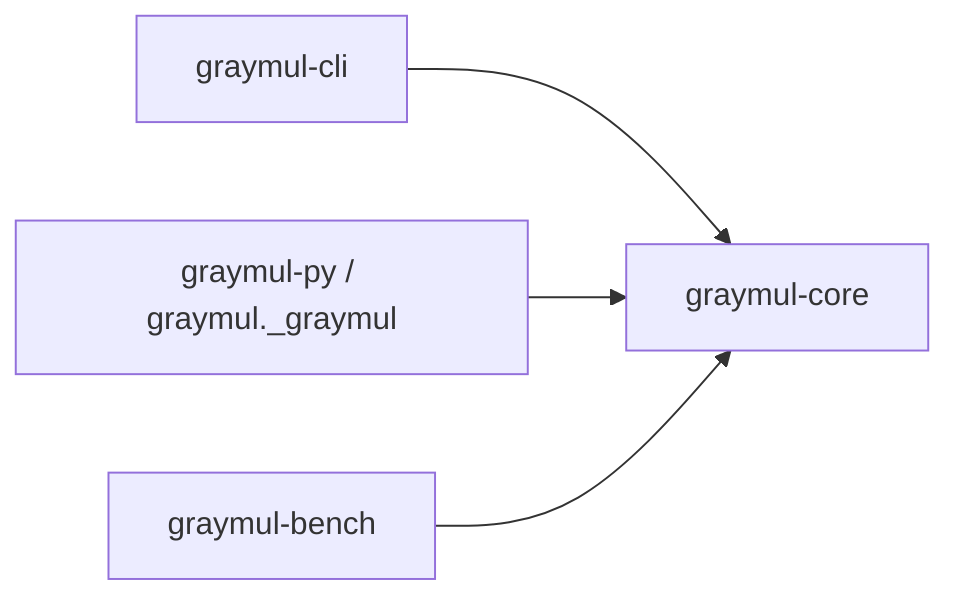
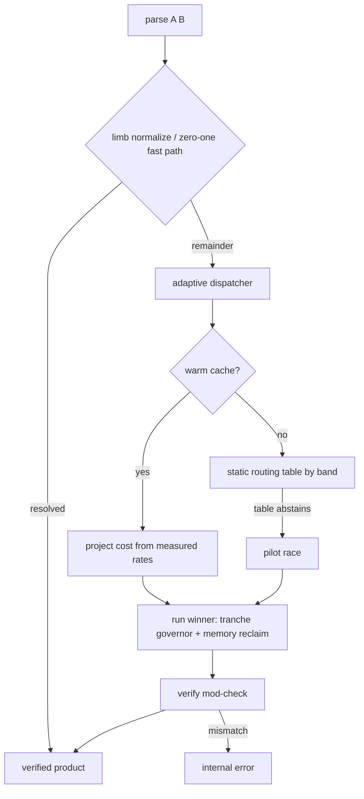

# GrayMUL · [](https://github.com/jake1104/GrayMUL/releases) [](#license) [](python/graymul/__init__.py)

Pure-Rust Harvey–van der Hoeven integer multiplication with adaptive multi-engine dispatch; measured cost picks the engine and every product is verified.

- **Adaptive dispatch:** schoolbook, Karatsuba, Toom-3, Toom-4, Schönhage–Strassen, Fürer, and Harvey–van der Hoeven share one ladder, plus an opt-in multivariate `hvh-full` engine. A static routing table owns the per-band choice, cold legs may run a pilot race, and projected-cost ties within 1% resolve toward `hvh`.
- **Verified output:** every reported product passes a three-modulus check — residues against two 30-bit primes plus the 61-bit Mersenne prime — with a length pin before it is returned. A wrong answer is a hard `internal` failure, never a silent one.
- **Budgets as errors:** time (`--timeout-seconds`) and memory (`--max-memory-mb`, default 1 GiB) end runs with a clean `resource-limit`, never an abort.
- **Reproducible bench:** every bench run writes an archive envelope carrying its own provenance (`task_id`, tier, timeout, threads, seeds, timestamp).

The numeric backend is `num-bigint` / `num-traits` over `u64` limbs (no GMP). The CLI binary uses `mimalloc` by default; the Python wheel is unaffected.

- [Quick start](#quick-start)
- [Installation](#installation)
- [CLI usage](#cli-usage)
- [Python usage](#python-usage)
- [WebAssembly](#webassembly)
- [Benchmarks](#benchmarks)
- [Architecture](#architecture)
- [Correctness](#correctness)
- [Building and testing](#building-and-testing)
- [Contributing](#contributing)
- [Release notes](#release-notes)
- [License](#license)

## Quick start

```powershell
cargo build -p graymul-cli --release
.\target\release\graymul.exe 12345 67890
```

```text
A: 12345
B: 67890
product: 838102050
method: schoolbook
limbs: 1
elapsed_ms: 0
```

```python
>>> import graymul
>>> graymul.multiply(12345, 67890)
838102050
```

## Installation

Prerequisites: a Rust stable toolchain plus a C compiler (the default allocator builds C sources; `--no-default-features` skips it), Python 3.8 or later, and maturin for the wheel.

```powershell
cargo build -p graymul-cli --release
.\target\release\graymul.exe 12345 67890
python -m maturin build --release --out dist
python -m pip install --force-reinstall --no-deps dist\graymul-0.1.1-cp38-abi3-win_amd64.whl
```

## CLI usage

### Multiplying two integers

```text
> graymul.exe 12345 67890 --timings
A: 12345
B: 67890
product: 838102050
method: schoolbook
limbs: 1
elapsed_ms: 0
stage: pilot                degree: n/a  elapsed_ms: 0        static-route engine=schoolbook band=1-64 limbs=1 tranche=1
stage: schoolbook           degree: n/a  elapsed_ms: 0        engine=schoolbook limbs=1 winner=true tranche=1
stage: verify               degree: n/a  elapsed_ms: 0        engine=schoolbook limbs=1 winner=true tranche=1 verify_ns=700
```

### Negative inputs

Operands accept an optional leading `+`/`-` sign; the sign never reaches the engine — the magnitude is multiplied and the sign reapplied, and `-0` normalizes to `0`. A leading `-` looks like a flag to the CLI, so pass `--` first:

```text
> graymul.exe -- -5 3
A: -5
B: 3
product: -15
method: schoolbook
limbs: 1
elapsed_ms: 0
```

Without `--`, `-5` exits 2 with a clap usage error. Magnitude limits ignore the sign: a 5000-digit operand multiplies the same way with or without a leading `-` (the Python digit cap likewise trips on magnitude, failing with `input` either way).

### JSON output

With `--json` the report is a single JSON object on stdout with keys `input_a`, `input_b`, `product` (decimal string), `method`, `limbs`, and `elapsed_ms`, plus a `timings` array of `{stage, degree, elapsed_ms, detail}` only when `--timings` is also passed. A failed run instead emits `{"error": {"category": ..., "detail": ...}}` and exits 1.

```json
{"elapsed_ms":0,"input_a":"12345","input_b":"67890","limbs":1,"method":"schoolbook","product":"838102050"}
```

With `--progress`, per-event lines stream to stderr while stdout keeps the final report (or pure `--json`).

### Batch mode

`graymul batch --input pairs.txt` multiplies one `A B` pair per line, streaming one JSON object per line to stdout. Each record carries keys `input_a`, `input_b`, `product` (decimal string or `null`), `method` (present on success), `status` (`ok` or `error`), `elapsed_ms`, and `error` (`null` on success, `"<category>: <detail>"` on failure). `--continue-on-error` records a bad line and keeps going instead of aborting the whole run.

```text
> graymul.exe batch --input pairs.txt --continue-on-error
{"elapsed_ms":0,"error":null,"input_a":"12345","input_b":"67890","method":"schoolbook","product":"838102050","status":"ok"}
{"elapsed_ms":0,"error":null,"input_a":"7","input_b":"8","method":"schoolbook","product":"56","status":"ok"}
{"elapsed_ms":0,"error":"input: invalid integer abc","input_a":"abc","input_b":"def","method":null,"product":null,"status":"error"}
```

Exit code is 0 only when every line succeeds; any failure — or a cancellation — exits 1.

### Explaining the plan

`graymul explain A B [--json]` prints the execution plan without multiplying: operand limbs and sign, the static-band route versus the warmed-cache override, resource estimates, and the verification methods.

```text
> graymul.exe --threads 4 explain 12345 67890
input_a: 12345
input_b: 67890
operands: limbs_a=1 limbs_b=1 limbs_max=1 ratio=1.000 negative=false
dispatch: static_route=schoolbook selected=schoolbook reason=static-band
warmed_override: none
resources: workers=4 est_memory_bytes=4194400 timeout_ms=3600000
verification: methods=mod-check,length-pin
```

With `--json` the same plan is a single object with keys `operands`, `dispatch`, `resources`, `verification`. `static_route` is the cold-table band choice; `selected` differs only when `reason` is `warmed-override` (warmed rate data outvoted the table), and the override is always repeated on its own `warmed_override` line (`none` when the table stands).

### Interrupting a run

Ctrl+C cancels the run: the CLI prints `error: cancelled: the operation was cancelled` on stderr and exits 1. In batch mode the line in flight records a `cancelled` error and the command exits 1 without starting further lines.

### Exit codes

- Exit code is 0 on success and 1 on failure (invalid input, budget expiry, cancellation, internal error).
- A failed run prints `error: <category>: <detail>` on stderr (verified: `error: input: invalid integer abc` for `abc`; `error: resource-limit: ...` on budget expiry), where `category` is one of `input`, `resource-limit`, `cancelled`, or `internal`. `cancelled` is reported when a run is cancelled: Ctrl+C on the CLI, or a falsy return from a Python progress callback.
- With `--timings`, stage records print on stdout even for failed runs, except runs that fail before `A`/`B` parse (e.g. an invalid decimal): those never carry `timings`.

### Full CLI flag table

| flag | default | meaning |
| :--- | :------ | :------ |
| `--algorithm` | `auto` | engine selection: `auto`, or one of `schoolbook`, `karatsuba`, `toom3`, `toom4`, `ssa`, `furer`, `hvh`, `hvh-full` |
| `--timings` | off | print a per-stage timing breakdown |
| `--json` | off | emit the result as a single JSON object on stdout |
| `--threads` | all logical cores | thread budget: sizes engine memory budgets in this CLI; drives the `ssa` and split legs on bench naked/interleave tiers |
| `--timeout-seconds` | unset (no deadline) | overall budget in seconds; on expiry the run ends with a clean `ResourceLimit` |
| `--max-memory-mb` | unset (1 GiB budget) | cap estimated multiply memory in MiB; over-budget estimates demote the engine, then halve workers, else fail cleanly with `resource-limit` |
| `--max-cpu-seconds` | unset (no budget) | process-wide CPU-time budget in seconds |
| `--seed` | absent (0x9e3779b97f4a7c15) | seed for the deterministic RNG |
| `--perf-mode` | off | mark timing records as performance-mode runs without changing behavior |
| `--progress` | off | stream per-event multiply progress to stderr (`--json` stdout stays pure) |

Engine entry cutoffs ship as named initial values (karatsuba 1024, toom3 64, toom4 512, ssa 512, furer 2048 with a truncating ring route at 4096, hvh 4096, hvh-full 64 with adaptive depth above 2048 limbs). The per-band winner lives in `bench/routing.json` (2 certified, 5 conservative); projected-cost ties within 1% resolve toward `hvh`.

## Python usage

### Multiplying two integers

```python
import graymul

graymul.multiply(12345, 67890)                  # 838102050
graymul.multiply(12345, 67890, algorithm="hvh")  # 838102050
graymul.multiply_report(12345, 67890)["method"]  # 'schoolbook'
graymul.version()                               # '0.1.1'
graymul.stage_timings(12345, 67890)             # [{'stage': 'pilot', ...}, ...]
```

All outputs above were verified live against the installed 0.1.1 wheel.

Every entry point in this section (`multiply`, `multiply_with_progress`, `stage_timings`, `multiply_report`, `multiply_batch`, `explain`) accepts negative operands: the sign is carried outside the engine and reapplied to the product, and `-0` normalizes to `0` (verified: `multiply(-12, -34)` is `408`, `multiply_report(-12, 34)["method"]` is `'schoolbook'`). The error taxonomy is unchanged — an over-magnitude negative fails exactly like its positive twin, e.g. `multiply(-(10**5000), 3)` raises `GrayMULError` with category `input` (`Exceeds the limit (4300 digits) ...`).

### Python keywords at a glance

`graymul.multiply`, `graymul.multiply_with_progress`, `graymul.stage_timings`, and `graymul.multiply_report` share one keyword surface, all keyword-only after `a, b`:

| parameter | default | meaning |
| :--- | :------ | :------ |
| `algorithm` | `None` | auto-select; pass an engine name to force it (`hvh-full` allowed explicitly, never in the auto race) |
| `threads` | `None` | worker count; `None` = all logical cores |
| `timeout_seconds` | `None` | overall budget; `None` = no deadline |
| `max_memory_mb` | `None` | memory cap in MiB; `None` = 1 GiB budget |
| `max_cpu_seconds` | `None` | CPU-time cap in seconds; `None` = no budget |
| `seed` | `None` | pin the deterministic RNG |
| `perf_mode` | `False` | mark timing records without changing behavior |

- Products return as Python ints; the CLI `--json` report carries them as decimal strings. Products above ~4300 digits need `sys.set_int_max_str_digits` raised (CPython guard, not a library limit).
- `multiply_with_progress(a, b, callback, *, ...)` calls `callback` with `{stage, current, total, message}` per engine boundary; a non-callable callback raises `TypeError`. Return a falsy value (e.g. `False`) from the callback to cancel the run: the computation stops and a `GrayMULError` with `category == "cancelled"` is raised. Truthy values and `None` continue.
- `stage_timings(a, *, ...)` returns `[{stage, degree, elapsed_ms, detail}]`, one `pilot` record per raced engine plus the winner record.
- `multiply_report(a, *, ...)` runs one call and returns `{product, method, limbs, elapsed_ms, timings}`.
- Failures raise `GrayMULError` (a `ValueError`) with byte-identical text:

| `.category` | when |
| :--- | :--- |
| `input` | bad input, e.g. an over-4300-digit operand that exceeds CPython's int/string conversion cap |
| `resource-limit` | budget expiry, e.g. a timed-out run |
| `cancelled` | the run was cancelled: a progress callback returned a falsy value, or Ctrl+C interrupted the CLI run |
| `internal` | unexpected internal failure |

Bad types raise `TypeError`. The Rust computation releases the Python GIL, so concurrent `multiply` calls overlap.

### Cancelling from a callback

```python
>>> import graymul
>>> def stop_at_first(event):
...     return False
>>> graymul.multiply_with_progress(12, 34, stop_at_first)
Traceback (most recent call last):
...
graymul.GrayMULError: cancelled: the operation was cancelled
```

### Explaining the plan

`graymul.explain(a, b)` returns the execution plan as a dict with keys `operands`, `dispatch`, `resources`, `verification` — no multiplication runs. The `dispatch` section keeps the static band route (`static_route`) and the warmed-cache override (`warmed_override`, `None` when the table stands) on separate keys, with `reason` either `static-band` or `warmed-override`. Verified: `explain(12345, 67890)["dispatch"]` is `{'static_route': 'schoolbook', 'selected': 'schoolbook', 'reason': 'static-band', 'warmed_override': None}`, and `explain(-12, 34)["operands"]["negative"]` is `True`.

### Batch multiplication and determinism

- **Batch:** `graymul.multiply_batch(pairs, fail_fast=True, ...)` multiplies a list of `(a, b)` pairs with the same keywords. It returns one product per pair; on failure it either raises (`fail_fast=True`) or records the `GrayMULError` in place (`False`). Verified: `multiply_batch([(12, 34), (7, 8)])` gives `[408, 56]`.
- **Determinism:** `seed` pins the deterministic RNG — the same seed repeats the same run.

## WebAssembly

`crates/graymul-wasm` exposes two functions: `multiply(a, b, budgetMs)` and `version()`. A success returns JSON with keys `ok`, `inputA`, `inputB`, `product`, `method`, `limbs`, `elapsedMs`, `stages` (each stage carries `stage`, `degree`, `ms`, `detail`); a failure returns `ok`, `inputA`, `inputB`, `error`. Nonzero budgets clamp to 1000–10000 ms (`0` means no limit); the module pins threads to 1, memory to 512 MiB, and a fixed seed. `multiply` is synchronous and blocks the page — always call it from a Web Worker, never the main thread; `examples/wasm-demo` shows the worker wiring (`worker.js` posts `{id, a, b, budgetMs}`, `app.js` respawns the worker to cancel).

```powershell
wasm-pack build crates/graymul-wasm --target web --release --out-dir pkg
node scripts/wasm-smoke.mjs
```

```text
version: 0.1.1
summary: 3/3 PASS failed 0
```

## Benchmarks

Numbers below are measured medians on the release binary (paired same-binary interleave tiers, warmup discarded, every record verify-checked), except where noted. Time is reported as bands and ratios, never as pinned timings: sub-millisecond cells sit on the 100 ns timer floor, and absolute legs wander run to run — only paired same-binary deltas carry meaning.

| limbs | engine | ours / num-bigint | verdict |
| :--- | :----- | :---------------- | :------ |
| 1 | schoolbook | 1.00 | MET (tie) |
| 2 | schoolbook | 1.00 | MET (tie) |
| 4 | schoolbook | 1.33 | MISS (timer floor, paired delta 0) |
| 8 | schoolbook | 0.83 | MET (paired delta 0) |
| 16 | schoolbook | 1.19 | MISS |
| 32 | schoolbook | 1.01 | MET |
| 64 | schoolbook | 1.32 | MISS (certified loss) |
| 128 | schoolbook | 1.61 | MISS (certified loss) |
| 256 | schoolbook | 2.12 | MISS |
| 512 | schoolbook | 2.79 | MISS (certified loss) |
| 1024 | toom3 | 1.87 | MISS |
| 2048 | toom4 | 2.00 | MISS |
| 4096 | toom4 | 1.70 | MISS |
| 8192 | toom4 | 2.10 | MISS |
| 16384 | toom4 | 1.39 | MISS |

Target met on 4 of 15 cells. Named owners for the misses: schoolbook kernel constants at 64/128 limbs; algorithm class (opponent runs Karatsuba) at 256/512; toom leaf-dominance plus per-op allocation traffic at and above 1024 limbs. A same-binary AVX-512/AVX2 SIMD path exists but is unratcheted (at parity with the autovectorizer); a same-binary toom4 self-recursion exists but its effect sits below the run-state floor.

Against an independent fast leg, Malachite 0.4.22 is faster than GrayMUL on all 15/15 cells by 7–50x (per-cell ratios 0.02–0.15), faster than num-bigint on 13/15 (ties at 2/8 limbs on the timer floor, loses at 256 limbs, 1.95x — its own basecase-to-FFT transition valley), and faster than CPython 15/15 by 5–50x. Caveats: different days, binaries, and protocols across legs.

The ssa entry is unproven: the loss gap narrows monotonically to a point estimate crossing inside (4096, 8192] limbs, but neither adjacent cell clears its band, so no crossing is claimed; the lone certified ssa win (0.72x at 32768, single top-edge cell) carries no routing change. A same-day, same-binary rerun moved ssa-vs-toom4 legs ~2x without changing the code — run-state variance dominates absolute legs, which is why only paired same-binary comparisons certify anything here. The 500–1000 limb crossover target from the literature band is missed: truncation never fires under power-of-two sizing, hand SIMD matches the autovectorizer, and Bailey blocking engages only at transform length 65536 and above.

Routing bands (`bench/routing.json`): [1,64), [64,256), [256,1024) → schoolbook, conservative; [1024,2048) → toom3, certified; [2048,8192) → toom4, certified; [8192,16384), [16384,∞) → toom4, conservative. No band routes `ssa`, `furer`, `hvh`, or `hvh-full`: those engines are measured through explicit forcing, never through auto routing. `--tier asym` (`--engines <A,B>` required) pits two engines against each other on asymmetric small×big limb pairs; it is measurement-only and never changes production routing.

Pin corpus (`bench/pins.json`): five seeded cells, methods and limb counts pinned, time as upper bands only — never as pinned timings:

| cell | limbs | method | band upper |
| :--- | :---- | :----- | :--------- |
| tiny (1-limb) | 1 | schoolbook | 5000 ms |
| small (4-limb) | 4 | schoolbook | 5000 ms |
| medium (8-limb) | 8 | schoolbook | 5000 ms |
| large (32-limb) | 32 | schoolbook | 5000 ms |
| huge (128-limb) | 128 | schoolbook | 5000 ms |

Every cell passes the three-way smoke (bench verified, CLI product/method/limbs/band, Python product) 5/5 with observed `elapsed_ms` 0–1 ms against the 5000 ms bands. Bands only.

Every bench run writes its raw per-case observations to the `--output` JSON file (default `logs/graymul-benchmark.json`, local-only) as an archive envelope carrying its own provenance (`task_id`, tier, timeout, threads, seeds, timestamp):

```powershell
.\target\release\graymul-bench.exe --tier tiny --task-id readme --output logs\readme-bench.json
```

```text
case,tier,limbs_a,limbs_b,status,verified,method,elapsed_ms
tiny_pair,tiny,1,1,ok,true,schoolbook,0
```

## Architecture



| crate | role |
| :---- | :--- |
| `graymul-core` | engine ladder (schoolbook → Karatsuba → Toom-3 → Toom-4 → Schönhage–Strassen → Fürer → Harvey–van der Hoeven, plus opt-in multivariate `hvh-full`) with the adaptive dispatcher (static routing table, warmed-rate override, pilot-race fallback, tranche governor, memory reclaim) |
| `graymul-cli` | `graymul <A> <B>` command-line front end |
| `graymul-py` | PyO3 extension module exposed as the `graymul` Python package |
| `graymul-bench` | benchmark tiers with per-case deadlines and JSON output |

| engine | complexity | role |
| :----- | :--------- | :--- |
| Schoolbook limb double loop (`u128` accumulation) | $O(n^2)$ | baseline + correctness oracle for all engines |
| Karatsuba recursive split + sub-cutoff fallback | $O(n^{1.585})$ | small-medium candidate |
| Toom-3, eval points $\{0,1,-1,2,\infty\}$ | $O(n^{1.465})$ | medium candidate, certified band [1024, 2048) |
| Toom-4, eval points $\{0,1,-1,2,-2,3,\infty\}$ | $O(n^{1.404})$ | medium-large candidate, certified band [2048, 8192); self-recursion above 2048 limbs |
| Schönhage–Strassen (two-prime CRT, small-NTT backend) | $O(n \log n \log\log n)$ | large candidate; entry unproven above 8192 limbs |
| Fürer (recursive chunked SSA, negacyclic ring path above 4096 limbs) | $O(n \log n)$ | very-large candidate, structurally complete, not faster at realistic sizes |
| Harvey–van der Hoeven practical B (Bluestein + PFA two-prime CRT) | $O(n \log n)$ | large candidate |
| Harvey–van der Hoeven full, multivariate, adaptive depth (D=2 below 2048 limbs, D=3 above) + short-transform tables | $O(n \log n)$ | opt-in `--algorithm hvh-full` only |



## Correctness

```powershell
cargo test --workspace
python -m pytest -q python/tests
```

- Every engine cross-validates against schoolbook as oracle (randomized plus boundary pins: zero, one, `u64::MAX` carry chains, asymmetric lengths).
- No output returns before the three-modulus `verify` check (two 30-bit primes, `1000000007`/`1000000009`, plus the 61-bit Mersenne `2305843009213693951`) plus the length pin (`product` limbs never exceed `a` limbs + `b` limbs) passes. A wrong answer is a hard `internal` failure, never a silent one.
- `graymul-bench` tiers verify every answer against their deadlines:

```powershell
.\target\release\graymul-bench.exe --tier all --timeout-seconds 30
```

## Building and testing

```powershell
cargo fmt --all
cargo clippy --workspace --all-targets -- -D warnings
cargo test --workspace
```

`mimalloc` is the default allocator for `graymul-cli`. Single-machine
evidence only. Opt out explicitly:

```powershell
cargo build -p graymul-cli --no-default-features --release
```

Release, wheel, and Python suite:

```powershell
cargo build --release
python -m maturin build --release --out dist
python -m pip install --force-reinstall --no-deps dist\graymul-0.1.1-cp38-abi3-win_amd64.whl
python -m pytest -q python/tests
```

## Contributing

- Keep changes minimal and measured: one behavior per task, with the commands and outputs that prove it.
- Build and test locally first (`cargo fmt --check`, `cargo clippy --workspace --all-targets -- -D warnings`, `cargo test --workspace`, `cargo build --release`, `pytest`, version guard, API surface, perf smoke).
- Time is managed as bands only, never as pins: do not assert exact timings anywhere.

## Release notes

Release notes ship with each published release — see [GitHub Releases](https://github.com/jake1104/GrayMUL/releases) for the per-version notes.

## License

MIT.
